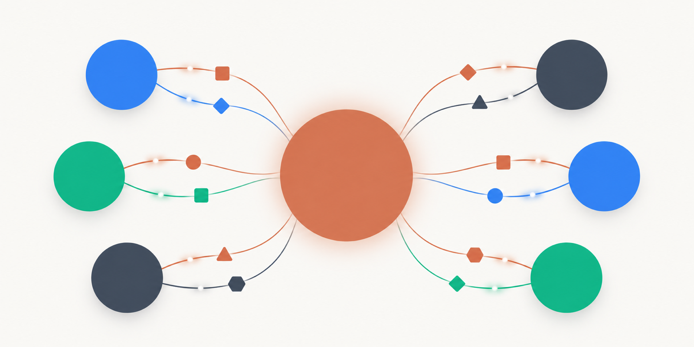
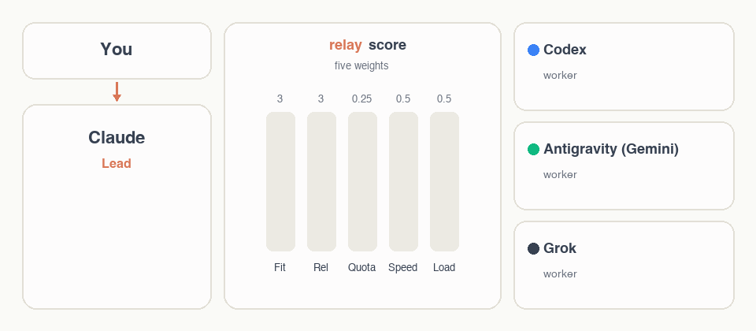
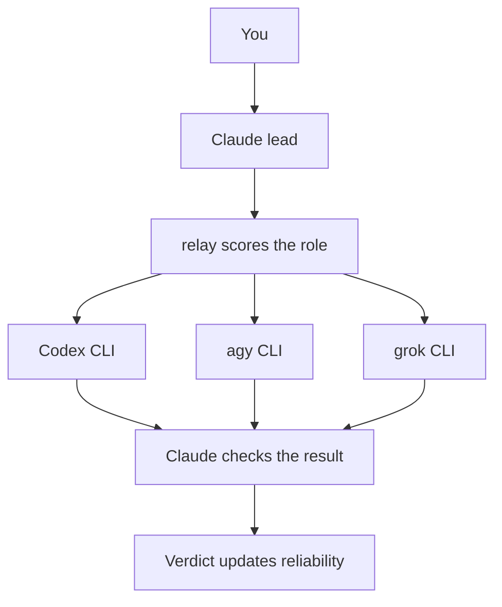
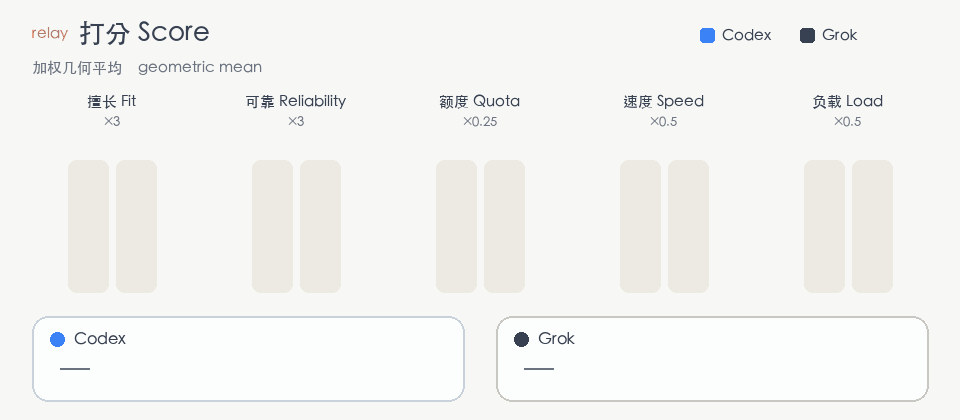
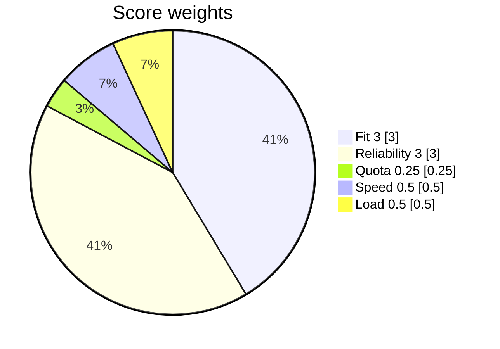
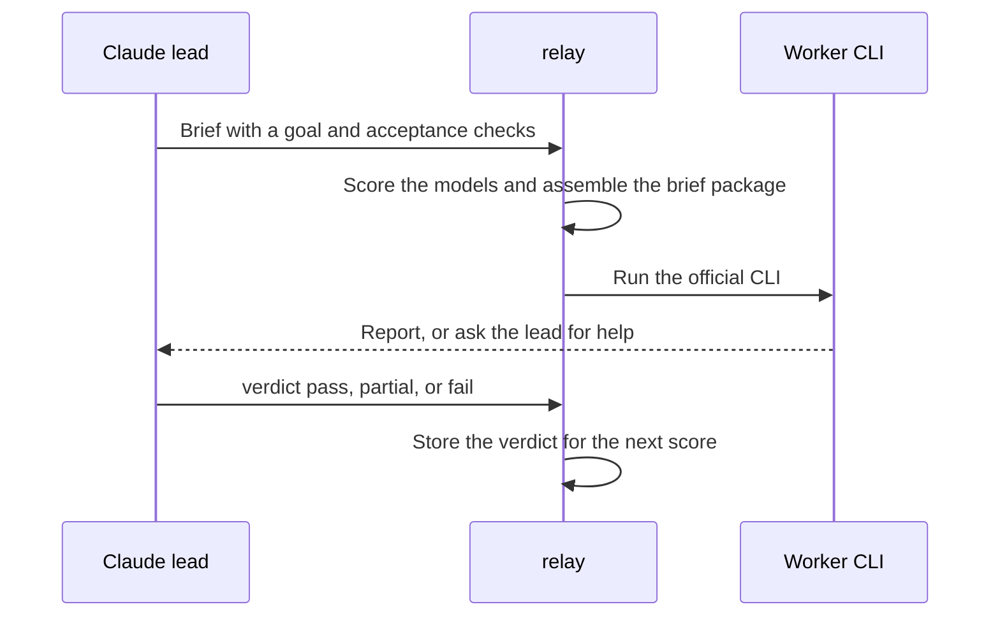

# ai-relay

[English](README.md) | [简体中文](README.zh-CN.md)

[](LICENSE)


<p align="center"></p>

Claude leads a team made of the AI memberships you already pay for. It scores each task on quality and remaining quota, then gives the work to the model that fits. Codex, Antigravity, and Grok run through their own official CLIs. No API key, and no proxy.

## ✨ Highlights

- 🧠 **Claude is the lead.** The model you pick in Claude Code plans the work, checks the result, and still does the parts only it can do.
- 👷 **Workers are official CLIs.** ChatGPT Plus (Codex), Antigravity (Gemini 3.8 Flash, Gemini 4 Argon, plus Claude and GPT on `agy`), and SuperGrok (`grok`).
- 🎯 **Quality decides the route.** The score is a weighted geometric mean. Fit and reliability weigh the most. A worker under 15% quota is skipped.
- 🛡️ **Each worker has a full-access switch.** Git stays read-only. Write scopes that overlap are refused, and edits outside the scope are flagged.
- 📊 **A local panel shows quota, the conversation, and providers.** Config, logs, and transcripts stay on your machine.

## 🧠 How it works

You talk to Claude. In auto mode Claude is the lead and the other models are workers. A worker never sees this chat. `relay` builds a brief, picks a model, and runs that vendor's official CLI. Claude checks the result and records a verdict. The verdict changes that model's reliability score next time.

<p align="center"></p>



The score is a weighted geometric mean of five terms. One weak term pulls the total down. With the default weights, fit and reliability outweigh a merely fuller quota, as long as the worker is still above the 15% floor.

<p align="center"></p>



Change the weights with `scoreWeights` in `providers.json`.

One dispatch looks like this:



Workers that cannot do a step say so under the heading `需要主控协助`. Claude then does that step itself, sends it to a worker that has the capability, or asks you. It does not let the worker guess.

| | Claude alone | With ai-relay |
|---|---|---|
| Who does the work | The model you selected does the whole task | That model leads. Codex, Antigravity, and Grok take the parts they fit |
| Quota | One subscription | The memberships you already pay for, through official CLIs |
| Choosing a model | You switch models by hand | Scored by fit, reliability, quota, speed, and load |
| Context | The chat has it | Workers never see the chat. The brief package carries the project and the task |
| Editing the repo | Claude's own permissions | A declared write scope, overlap refusal, an out-of-scope check, and read-only git for workers |
| Stop dispatching | | `/ai-relay:relay off` returns to Claude only |

### Three modes

The default is manual.

| Mode | Command | Behavior |
|---|---|---|
| Claude only | `/ai-relay:relay off` | No dispatch. The Codex plugin `codex@openai-codex` is disabled. Hooks inject nothing and block outbound work |
| Manual | `/ai-relay:relay manual` | Claude works. A worker runs only when you name it |
| Auto | `/ai-relay:relay auto` | Claude leads: it splits, assigns, checks, and reports, and it still does work itself |

Turning the Codex plugin on or off takes full effect in a new session. The hooks follow the new mode in the current session.

## 🧰 Features

### Orchestration

Auto mode is a lead-and-workers split, not a fixed pipeline. Claude tends to dispatch a block of reading, implementation, debugging, or an independent review, and work that can run in parallel. It tends to keep small edits, short answers, secrets, and anything that needs Claude's own tools: the browser, Office files, connectors, and MCP.

Put `ulw` (or `ultrawork`) in a message to force that orchestration on the current turn.

Seven roles:

| Role | Used for |
|---|---|
| `implement` | A chunk of implementation |
| `debug` | Finding the cause |
| `review` | An independent review. A non-trivial change is reviewed by a different vendor |
| `read` | Reading a lot of code or docs |
| `deep` | Comparing designs |
| `quick` | A short answer |
| `claude-backup` | Execution when Claude's own quota is tight |

A usual feature path is `read`, then `implement`, then a `review` from another vendor. Claude checks each step and records `relay verdict`.

Auto mode also watches how much of Claude's own quota is left, and narrows what the lead executes. See [Claude-aware throttling](#claude-aware-throttling).

### Claude-aware throttling

In auto mode, relay takes the minimum remaining ratio across Claude's pools and windows. That ratio picks a gear. A gear changes how much the lead executes. The acceptance standard stays the same.

| Gear | When | What the lead does |
|---|---|---|
| Normal | At least 50% left, or the quota is unknown | The usual split: big chunks go out, small edits and short answers stay |
| Throttle | Below 50%, and still at least 20% | The lead keeps to the request, the split, the brief, the check, and the report. Reading more than two files, debugging, implementation, review, and any question that needs the code are dispatched. Reading and short answers go to the worker with the most quota left. Briefs and reports stay short |
| Conserve | Below 20% | Reading code, debugging, implementation, review, and fixes are dispatched whenever a worker can take them. The lead keeps the split, writes a clear brief, and checks strictly. The report stays short, and the conclusion stays complete. Below 5%, the lead suggests `/codex:transfer` |

**Quality floor, in every gear.** The lead personally checks acceptance and spot-checks the conclusions that matter. Work that no worker is good at, or that needs this conversation to judge, stays with the lead. A result that misses the acceptance checks is sent back or finished by the lead.

While throttling or conserving, a turn in which the lead reads files more than 8 times (`selfReadMax`, default 8, including search) gets a reminder to dispatch the rest of the reading and debugging with `relay pick read`, and to read what the workers found.

`claudeThrottleBelow` defaults to `0.5`. `claudeConserveBelow` defaults to `0.2`. Both are set in `providers.json`.

### Routing

Every brief must state a difficulty, `难度：简单|中等|困难` (easy / medium / hard), or the run is refused. Models sit in three tiers (`modelTiers`): light (Gemini 3.8 Flash, Codex GPT-6-Luna and GPT-5.6), mid (Grok, Argon medium/low, Sonnet, Codex GPT-6.1-Terra and GPT-6-Sol) and strong (Codex GPT-6-Astra and GPT-6.1-Sol, Argon high, Opus). Codex models share one quota, and the reasoning effort follows the difficulty (`--effort low|medium|high`). Easy work may go to any tier and favours cheap models with spare quota. Medium work needs mid or strong. Hard work goes to strong models only; when none has quota, Claude does it or passes `--downgrade "<reason>"`.

`relay pick <role> --level <difficulty>` prints the first choice, the backups, and the models it skipped, each with a reason.

| Term | Weight | How it is calculated |
|---|---|---|
| Fit | 3 | Earlier in the route list scores higher: 1.0, then −0.15 per step, floor 0.4. A 4th segment sets the value, for example `agy:gemini:gemini-3.8-flash-high:0.75` |
| Reliability | 3 | History plus your verdicts (`pass` / `partial` / `fail`). The same role counts in full. Other roles count half |
| Quota | 0.25 (lowest) | More remaining scores higher. A high balance that resets soon scores higher, because unused quota expires. Under 30% the quota term is multiplied by 0.7. **Under 15% the worker is skipped** |
| Speed | 0.5 | A longer history of run time scores lower |
| Load | 0.5 | More tasks already running on that vendor scores lower, so parallel work spreads out |

Default route order, which is the fit order. The live pick still applies the full score:

| Role | Default order |
|---|---|
| `implement` | Codex → Gemini 4 Argon → Grok → agy Claude Sonnet → Gemini 3.8 Flash |
| `debug` | Codex → Grok → Gemini 4 Argon → agy Claude Opus → Gemini 3.8 Flash |
| `review` | Grok → Gemini 4 Argon → Gemini 3.8 Flash → Codex |
| `read` | Gemini 3.8 Flash → Gemini 4 Argon → Grok |
| `deep` | Gemini 4 Argon → agy Claude Opus → Codex |
| `quick` | Gemini 3.8 Flash → Grok |
| `claude-backup` | agy Claude Opus → Gemini 4 Argon → Codex |

A brief can declare `## 需要的能力` as web, shell, or none. The pick stays inside workers that have that capability. You can also pass `relay pick <role> --needs web,exec`.

With the full-access switch on (the default), the effective capabilities are:

| | Web | Shell | Browser, Office, connectors, MCP |
|---|---|---|---|
| Claude, the lead | Yes | Yes | Yes |
| Grok | Yes | Yes | No |
| agy | Yes | Yes | No |
| Codex | No. The sandbox is offline by default | Yes, inside its sandbox | No |

Turn a worker's switch off and agy or Grok loses the shell. Codex is not affected by the switch. The base `caps` in config are the values before that switch: Codex is `web: false, exec: true`; agy and Grok are `web: true, exec: false` until full access adds the shell.

### Context

A worker receives a brief package:

1. **Project context**, attached automatically: working directory, git branch, uncommitted changes, and the text of `AGENTS.md` / `CLAUDE.md` / `GEMINI.md`. Large rule files are passed as paths.
2. **Shared background**, from `relay context set`. Briefs for the same directory include it for 6 hours, including briefs sent to Codex.
3. **The brief itself.** `relay brief` prints the template. A brief without `目标` or `验收标准` is rejected. Those headings are matched in Chinese.
4. **Handoff material.** `--with <task-id>` attaches an earlier result. `--diff` attaches the current git diff. Reviews usually pass `--diff`.
5. **When the worker can run commands**, the package also includes the hard rules, the text of your `~/.claude/CLAUDE.md`, and your local skill list.

Codex is launched through the official Codex plugin. The hook adds the same project context and shared background to that prompt. agy and Grok are launched with `relay run`.

### Quota

Each vendor is read from its own official source:

| Vendor | Source |
|---|---|
| Claude | The current Claude Code session |
| Codex | Local Codex session records |
| agy | `agy` `/usage` |
| Grok | The grok.com billing API, called with the Grok CLI login token. The token stays in local process memory |

AIQuota5h is an optional fallback for a window the built-in reader missed. A new provider shows "quota unknown" until it has its own reader. Unknown quota ranks after a healthy balance and before a low one.

The status plugin refreshes quota at the end of a turn. agy and Grok are queried at most every 5 minutes unless you run `relay quota --force`. The panel draws a 5-hour bar and a weekly bar, with the reset time. Under 30% is marked low. Under 15% is not assigned work.

### Panel

Install `ai-relay-status` and open the panel with the `ai-relay · <mode>` button under the input, or with `/relay-bar`. Three pages:

- **Quota.** A 5-hour bar and a weekly bar per pool, plus the reset time. Switch mode from this page.
- **Conversation.** Every project and every session, grouped into turns: what the lead did and what each worker did. Open a turn for the task, why that worker was picked, and the verdict.
- **Providers.** Enable or disable a vendor, toggle full access, run a connectivity test, and add or remove a vendor. Templates: Kimi, Qwen, and custom.

## 📦 Installation

You need Node.js 18 or newer, and Claude Code 2.1.318 or newer.

Install and log in to the official CLIs you actually have: `codex`, `agy`, and `grok`. A missing CLI is skipped. Codex also uses the official plugin `codex@openai-codex`. Gemini models are reached through Antigravity (`agy`), not a separate Gemini CLI provider.

```bash
claude plugin marketplace add ming2363/ai-relay
claude plugin install ai-relay@ai-relay
claude plugin install ai-relay-status@ai-relay
```

`ai-relay` is the scheduler. `ai-relay-status` is the footer button and the side panel. Open a new Claude Code session after installing so the hooks load.

Marketplace name: `ai-relay`.

## 🚀 Quick start

1. Install both plugins with the commands above, then open a new session.
2. Log in to the CLIs you pay for. Check them with `relay providers`, or on the Providers page.
3. Switch to auto and describe the work:

```text
/ai-relay:relay auto
```

Or stay on manual (the default) and name someone: "have grok review this change". Add `ulw` in front of a request when you want the full multi-model pass. Open the panel with `/relay-bar`.

## ⌨️ Commands

`relay` below is `scripts/relay.mjs` in the `ai-relay` plugin:

```bash
node "${CLAUDE_PLUGIN_ROOT}/scripts/relay.mjs" status
```

| You want | Command |
|---|---|
| Switch mode | `/ai-relay:relay off` · `manual` · `auto` |
| Open or close the panel | `/relay-bar`, or the footer button |
| Mode, quota, and the current first choice per role | `/ai-relay:relay` or `relay status` |
| Pick a model and see why | `relay pick <role> --level easy\|medium\|hard` |
| Run a worker | `relay run <provider\|auto> --role <role>` |
| Hand agy or Grok a task from chat | `/ai-relay:ask grok --role review …` |
| List dispatches | `relay jobs` or `/ai-relay:relay jobs` |
| Delete expired local records and show disk use | `relay clean` |
| Record a verdict | `relay verdict <id> pass\|partial\|fail -- <one line>` |
| Shared background | `relay context set` · `show` · `clear` |
| Brief template, or a preview of the attached context | `relay brief` · `relay brief --context` |
| Refresh quota | `relay quota` |
| List providers | `relay providers` |
| Full access for one provider | `relay provider access <name> on\|off` |
| Force multi-model orchestration | Put `ulw` in the message |

Other script commands: `relay wait <id…>` (returns as soon as one job finishes; `--all` waits for every job), `relay rework <id> -- <feedback>` (sends a failed job back to the same worker with the feedback), `relay result <id>`, `relay cancel <id>`, `relay provider enable|disable|test|remove <name>`, `relay provider add <name> --preset kimi|qwen|custom`.

A `relay run` brief must contain the headings `目标` and `验收标准`. Add `--write` to allow edits. The default is read-only. `--background` runs a read-only job in the background. `--scope` and the brief's `## 写入范围` are the write scope.

## ⚙️ Configuration

User config is `~/.claude/ai-relay/providers.json`. The first run copies it from the plugin default. A plugin update does not overwrite it.

```json
{
  "minRemaining": 0.15,
  "lowRemaining": 0.3,
  "selfEditMaxLines": 40,
  "workerFullAccess": true,
  "scoreWeights": {
    "fit": 3,
    "reliability": 3,
    "quota": 0.25,
    "speed": 0.5,
    "load": 0.5
  },
  "routes": {
    "review": [
      "grok:supergrok-weekly:default",
      "agy:gemini-argon:gemini-4-argon-high"
    ]
  }
}
```

Per provider, `fullAccessEnabled` overrides `workerFullAccess`, and `caps` declares the base capabilities:

```json
{
  "providers": {
    "grok": {
      "fullAccessEnabled": true,
      "caps": { "web": true, "exec": false }
    }
  }
}
```

| Field | Default | What it does |
|---|---|---|
| `routes` | See the plugin default | Ordered candidates per role, shaped `provider:pool:model` or with a 4th fit segment |
| `scoreWeights` | 3 / 3 / 0.25 / 0.5 / 0.5 | Weights of the geometric mean: fit, reliability, quota, speed, load |
| `minRemaining` | `0.15` | Remaining quota below this skips the worker |
| `lowRemaining` | `0.3` | Below this, the quota term is multiplied by 0.7. The worker can still be picked |
| `selfEditMaxLines` | `40` | If the lead writes more than this many lines in one turn, a hook reminds it to consider dispatching. The conversation page shows the count. The edit is not blocked |
| `fullAccessEnabled` | Follows `workerFullAccess` (`true`) | Per-worker switch. On: agy adds `--dangerously-skip-permissions`, Grok adds `--always-approve`. Off: that worker cannot run commands. Codex ignores it and stays in the official sandbox |
| `caps` | Per provider | Base `web` and `exec` before the full-access switch. `## 需要的能力` filters on the effective capability |

Related knobs in the same file: `claudeThrottleBelow` (default `0.5`), `claudeConserveBelow` (default `0.2`), `selfReadMax` (default `8`), and `staleMinutes` (default `15`). A quota reading older than that is marked stale. `quotaDb` points at an optional AIQuota5h database.

## ➕ Adding a new provider

Any official CLI that can run one non-interactive command and print the result can be added.

**Panel.** `/relay-bar` → Providers → Add provider. Pick Kimi Code CLI, Qwen Code, or custom. Fill in the id, label, command, models, and roles, then save. The new provider is appended to those roles. On a phone, the panel has no form; add the provider from the desktop app or the terminal.

**Terminal.**

```bash
relay provider add kimi --preset kimi
relay provider add qwen --preset qwen
relay provider add mycli --preset custom
```

Then `relay provider test <name>` runs one read-only sentence in an empty directory. That call spends a little quota. `relay provider remove <name>` deletes it from every route and backs up the config to `providers.json.bak`. The panel asks you to confirm twice.

Codex can be disabled and cannot be removed, because it goes through the official plugin. Claude cannot be disabled. Use `/ai-relay:relay off` when you want Claude only.

The Kimi preset's non-interactive mode approves tool calls, so read-only runs use plan mode and relay checks a git snapshot for unexpected edits. The Qwen preset uses plan mode for reading and `auto-edit` for writing. `auto-edit` approves file edits and does not approve shell commands.

## 🛡️ Safety model

Full access is on by default, one switch per worker. Turn it off on the Providers page or with `relay provider access <name> off`. While it is on, agy and Grok can run commands without a prompt for each one. The brief then carries three constraints: the hard rules, your `~/.claude/CLAUDE.md`, and your local skill list.

Workers follow these rules:

- Git is read-only (`status`, `diff`, `log`, `show`). Workers do not commit, push, merge, rebase, or open a pull request. Claude does that only after you ask in the current turn.
- A database or a server is touched only when the brief names it and allows it, and only for a read: `SELECT`, logs, and status. Workers do not apply DDL, DML, migrations, config edits, or restarts.
- A worker may read a secret when the task needs it. It does not print the value, change the file, or send it anywhere.
- A writable brief lists `## 写入范围`. Scopes that do not overlap may run together. Overlapping scopes are refused by relay and by the Codex hook. After the run, files outside the scope are flagged for the verdict.
- No `sudo`, no global installs, and no edits to tool config such as `~/.claude`, `~/.codex`, or `~/.grok`.
- If a step is unsafe or impossible, the worker stops and writes `需要主控协助`.

Codex is fixed to the official plugin sandbox and can write the current project only. `relay pick <role> --write --target <dir>` skips Codex when the directory is outside that sandbox, and the hook refuses a Codex brief whose write scope leaves the sandbox.

Read-only tasks can run in parallel with `--background`. Wait for them with `relay wait <id1> <id2>`. It returns when the first one finishes, so Claude checks each result as it arrives and sends a failed one back with `relay rework`.

## 💾 Data and privacy

Everything is local, under `~/.claude/ai-relay/`. Set `AI_RELAY_HOME` to move it.

| What | Where | Kept for |
|---|---|---|
| Provider config | `providers.json` | Until you change or delete it |
| Current mode | `mode` | Until you change it |
| Quota cache | `quota-cache.json` | Replaced on refresh |
| Dispatch tasks | `jobs/` | 30 days |
| Codex subagent log | `history.jsonl` | 30 days |
| Conversation turns | `rounds/` | 14 days |
| Recent prompt excerpts | `prompts/` | 7 days |
| Shared background | `context/` | 7 days. A brief only attaches it for 6 hours |

Cleanup runs at most once a day, on the next message after 24 hours. `relay clean` runs it immediately and prints the disk use. Lock files and probe leftovers older than a day are removed in the same pass.

To uninstall: `claude plugin uninstall ai-relay@ai-relay` and `claude plugin uninstall ai-relay-status@ai-relay`. Delete `~/.claude/ai-relay/` if you also want the local data gone.

The Grok quota call reads the CLI login at `~/.grok/auth.json`. The token is used in process memory for that request. It is not written to logs, not placed in command arguments, and not included in errors. When the token is expired, relay does not refresh it, so it does not race the `grok` CLI. Quota then stays on the previous cache, or on AIQuota5h if that database is present.

Briefs are not supposed to contain secrets or `.env` contents. The lead is told to keep them out.

## ❓ FAQ

**A CLI is not installed. Does the plugin fail?**

No. That provider is skipped. Install and log in when you want it, then check `relay providers` or the Providers page. `relay provider test <name>` checks that the command runs.

**How do I go back to Claude only?**

`/ai-relay:relay auto` and `manual` turn dispatch back on. `/ai-relay:relay off` turns it off: hooks block dispatch immediately, and the Codex plugin is disabled. The plugin toggle takes full effect in a new session. Disabling a single vendor on the Providers page skips that vendor only. Claude itself cannot be disabled.

**Will a worker rewrite the repo?**

A read-only dispatch does not get a write mode. A writable dispatch has to name its write scope, and an overlapping scope is refused. Afterward, edits outside the scope are flagged. Workers cannot commit or push. Codex cannot write outside the current project. Turn off full access and agy or Grok can no longer run commands. Claude still has to accept the diff. A worker report is evidence, not the conclusion.

**Where do the quota numbers come from?**

From each product, on this machine. Claude reads the current session. Codex reads local session records. agy runs `/usage`. Grok calls the grok.com billing API with the CLI login token, in memory only. AIQuota5h is optional and fills a window the built-in reader missed. A provider you add yourself shows unknown quota until a reader exists. Refresh from the panel, or run `relay quota`.

**Why does `relay run auto` stop when Codex is the first choice?**

Codex is not started by `relay run`. It goes through the official Codex plugin, so the lead hands over the brief with the Agent tool and `subagent_type` set to `codex:codex-rescue`. The first line of the prompt carries the run flags from `relay pick`, such as `--model gpt-6.1-sol --effort high`; when it is missing, the hook fills it in from the last pick and the difficulty. When `relay run auto` ranks Codex first, it stops and prints that instruction. The next worker is used only if you pass `--skip-codex`. A write target outside the current project skips Codex on its own, because the sandbox cannot write there.

## 🤝 Contributing

Issues and pull requests are welcome.

```text
plugins/ai-relay/            scheduler: scripts/relay.mjs, score.mjs, brief.mjs, quota.mjs
plugins/ai-relay/skills/orchestrate/SKILL.md
plugins/ai-relay-status/     footer button and side panel, hooks/register.tsx
.claude-plugin/marketplace.json
```

The marketplace name is `ai-relay`.

Core tests:

```bash
node --test plugins/ai-relay/scripts/score.test.mjs plugins/ai-relay/scripts/quota.test.mjs
```

The GIFs in this README are generated with:

```bash
python3 docs/scripts/make_gifs.py
```

The orchestration rules live in `plugins/ai-relay/skills/orchestrate/SKILL.md`. Keep the README in line with that file and with `config/providers.default.json` when a weight, a command, or a retention period changes.

## 📄 License

[MIT](LICENSE). Copyright (c) 2026 zhangming.
