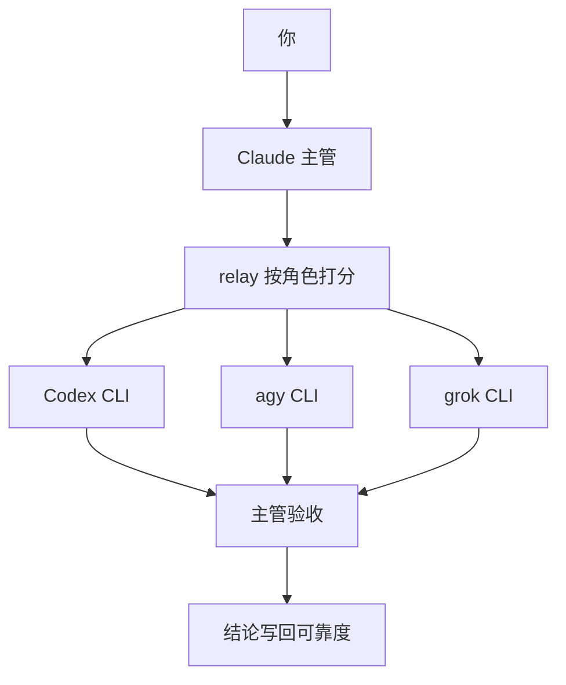
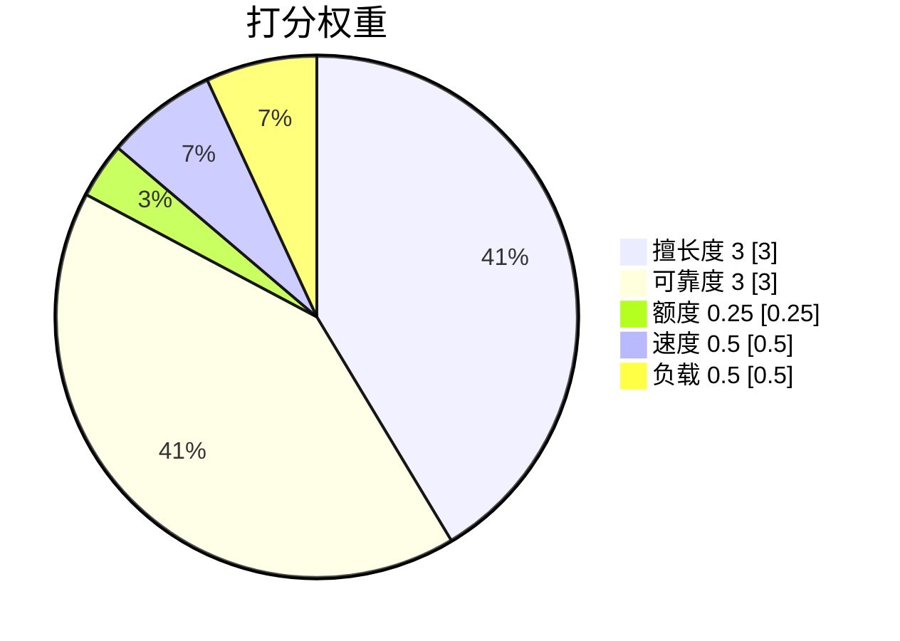
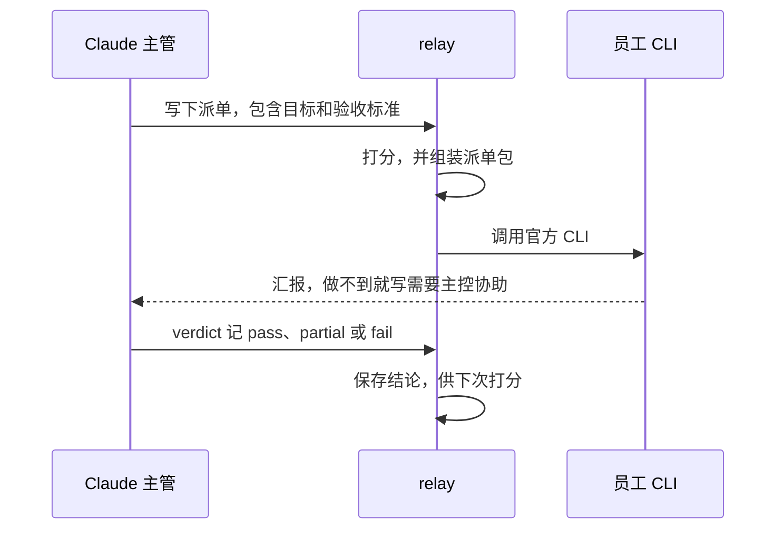

# ai-relay

[English](README.md) | [简体中文](README.zh-CN.md)

[](LICENSE)


把你已经付费的 AI 会员组成一支团队。你在模型菜单里选的 Claude 当主管，按质量和剩余额度把任务分给最合适的模型。Codex、Antigravity 和 Grok 走各自的官方命令行，不需要 API key，也不经过中转。

## ✨ 亮点

- 🧠 **Claude 是主管。** 它负责拆活、验收，也亲自做只有它能做的部分。主管就是你在 Claude Code 里选中的那个模型。
- 👷 **员工是各家官方 CLI。** ChatGPT Plus 的 Codex，Antigravity 上的 Gemini 3.8 Flash、Gemini 4 Argon，以及 agy 里的 Claude / GPT，还有 SuperGrok 的 Grok。
- 🎯 **按质量选人。** 分数是加权几何平均，擅长度和可靠度最重。额度低于 15% 的直接跳过。
- 🛡️ **每家有独立的最高权限开关。** 员工的 git 只读。写入范围重叠就拒绝启动，跑完还会检查有没有改到范围外面。
- 📊 **本机面板看额度、对话和厂商。** 配置、外派日志和对话记录都留在你的电脑上。

## 🧠 工作原理

你只和 Claude 对话。自动模式下，Claude 是主管，其他模型是员工。员工看不到这段对话。`relay` 负责组装派单、打分，并调用那家的官方 CLI。Claude 验收结果，记下结论。这个结论会改变该模型下一次的可靠度。



分数是五项的加权几何平均。某一项差，总分会被拉下来。默认权重下，只要额度还在 15% 以上，更擅长、更可靠的模型不会输给一个只是额度更满的模型。



权重在 `providers.json` 的 `scoreWeights` 里改。

一次外派的过程：



员工做不到的部分写在「需要主控协助」里。主管自己补上、改派给有这项能力的员工，或者来问你。不允许员工在缺信息时猜完。

| | 只用 Claude | 用 ai-relay |
|---|---|---|
| 谁干活 | 菜单里选中的模型做完全部 | 这个模型当主管，合适的部分交给 Codex、Antigravity、Grok |
| 额度 | 一份订阅 | 你已经在付费的会员，通过官方 CLI 使用 |
| 选模型 | 自己切换 | 按擅长度、可靠度、额度、速度、负载打分 |
| 上下文 | 对话里都有 | 员工看不到对话。派单包带上项目和任务 |
| 改仓库 | 按 Claude 自己的权限 | 声明写入范围，范围重叠就拒绝，跑完检查越界，员工 git 只读 |
| 停止外派 | | `/ai-relay:relay off` 回到纯 Claude |

### 三种模式

默认是手动。

| 模式 | 命令 | 行为 |
|---|---|---|
| 纯 Claude | `/ai-relay:relay off` | 不外派。Codex 插件 `codex@openai-codex` 被禁用。钩子不注入内容，并拦截外派 |
| 手动 | `/ai-relay:relay manual` | Claude 自己做。只有你点名时才派给员工 |
| 自动 | `/ai-relay:relay auto` | Claude 当主管：拆解、派发、核验、汇报，也可以自己干活 |

Codex 插件的启停要新会话才完全生效。当前会话里，钩子会马上按新模式执行。

## 🧰 功能

### 编排

自动模式是主管和员工的分工，不是一条写死的流水线。成块的阅读、实现、排查、独立审查，以及能拆开并行的活，倾向于外派。小改动、纯问答、密钥，以及必须用 Claude 自己工具的部分，倾向于主管自己做。这些工具包括浏览器、Office、连接器和 MCP。

在消息里加上 `ulw`（或 `ultrawork`），这一轮会按全力多模型编排来做。

七个角色：

| 角色 | 用来做 |
|---|---|
| `implement` | 成块实现 |
| `debug` | 查原因 |
| `review` | 独立审查。不简单的改动要换一家厂商再审一次 |
| `read` | 大量阅读代码或文档 |
| `deep` | 比较方案 |
| `quick` | 短问答 |
| `claude-backup` | Claude 自己额度紧的时候，替它做执行 |

常见的功能路径是 `read`，然后 `implement`，再换一家厂商做 `review`。主管逐步验收，并用 `relay verdict` 记下结论。

Claude 自己的 5 小时额度低于 `claudeConserveBelow`（默认 20%）时，主管只做拆解和审核，执行全部外派。注入的提示还会要求：低于 5% 时建议你使用 `/codex:transfer`。

### 路由

`relay pick <角色>` 会给出首选、备选，以及被跳过的模型，每家都附理由。

| 项 | 权重 | 怎么算 |
|---|---|---|
| 擅长度 | 3 | 路由表里越靠前越高：1.0，之后每位减 0.15，最低 0.4。第 4 段可以直接指定，例如 `agy:gemini:gemini-3.8-flash-high:0.75` |
| 可靠度 | 3 | 历史成败，加上你的验收结论（`pass` / `partial` / `fail`）。同一角色按满权重，其他角色算一半 |
| 额度 | 0.25（最低） | 剩得越多越高。剩得多而且快重置的加分，因为不用就作废。低于 30% 时额度项打七折。**低于 15% 直接跳过** |
| 速度 | 0.5 | 历史耗时越长越低 |
| 负载 | 0.5 | 这家正在跑的任务越多越低，并行时任务会散到不同厂商 |

下面是默认路由顺序，也就是擅长度的顺序。实际选谁还要看完整打分：

| 角色 | 默认顺序 |
|---|---|
| `implement` | Codex → Grok → agy 上的 Claude Sonnet → Gemini 3.8 Flash |
| `debug` | Codex → Grok → Gemini 4 Argon → agy 上的 Claude Opus → Gemini 3.8 Flash |
| `review` | Grok → Gemini 4 Argon → Gemini 3.8 Flash → Codex |
| `read` | Gemini 3.8 Flash → Gemini 4 Argon → Grok |
| `deep` | Gemini 4 Argon → agy 上的 Claude Opus → Codex |
| `quick` | Gemini 3.8 Flash → Grok |
| `claude-backup` | agy 上的 Claude Opus → Gemini 4 Argon → Codex |

派单可以写 `## 需要的能力`：联网、执行命令，或无。挑选只在具备这项能力的员工里进行。也可以直接运行 `relay pick <角色> --needs web,exec`。

最高权限开着时（默认开着），实际能力是：

| | 联网 | 执行命令 | 浏览器、Office、连接器、MCP |
|---|---|---|---|
| Claude 主管 | 能 | 能 | 能 |
| Grok | 能 | 能 | 不能 |
| agy | 能 | 能 | 不能 |
| Codex | 不能。沙箱默认断网 | 能，限在自己的沙箱里 | 不能 |

关掉某家的开关后，agy 或 Grok 就不能执行命令。这个开关不影响 Codex。配置里的 `caps` 是开关生效前的底数：Codex 是 `web: false, exec: true`；agy 和 Grok 是 `web: true, exec: false`，最高权限打开后才加上执行命令。

### 上下文

员工拿到的是一份派单包：

1. **项目上下文**，自动附上：工作目录、git 分支、未提交改动，以及 `AGENTS.md` / `CLAUDE.md` / `GEMINI.md` 的原文。规则文件太大时只给路径。
2. **共享背景**，用 `relay context set` 写一次。同一目录 6 小时内的派单都会附上，包括派给 Codex 的。
3. **派单正文。** `relay brief` 可以查看模板。缺少「目标」或「验收标准」会被退回。这两段标题按中文匹配。
4. **接力材料。** `--with <任务id>` 附上前一次的结果。`--diff` 附上当前的 git diff。审查一般带 `--diff`。
5. **员工能执行命令时**，派单包还会附上硬性规则、你的 `~/.claude/CLAUDE.md` 原文，以及本地技能清单。

Codex 通过官方 Codex 插件启动，钩子会给那份 prompt 补上同样的项目上下文和共享背景。agy 和 Grok 用 `relay run` 启动。

### 额度

每家用自己的官方来源读取：

| 厂商 | 来源 |
|---|---|
| Claude | 当前 Claude Code 会话 |
| Codex | 本机的 Codex 会话记录 |
| agy | `agy` 的 `/usage` |
| Grok | 用 Grok CLI 的登录令牌查 grok.com 计费接口。令牌只留在本机进程内存里 |

某一窗口自查没有数据时，可选的 AIQuota5h 用来补上。新加的厂商在接上自己的读取方式之前显示「额度未知」。未知额度排在额度充足的厂商之后、额度偏低的厂商之前。

状态插件在每轮结束时刷新额度。agy 和 Grok 默认至少隔 5 分钟才查一次，要立刻更新就运行 `relay quota --force`。面板上每家有 5 小时和周两条额度条，并显示重置时间。低于 30% 标为偏低，低于 15% 不再派活。

### 面板

装上 `ai-relay-status` 之后，点输入框下方的 `ai-relay · <模式>` 按钮，或输入 `/relay-bar`。面板有三页：

- **额度。** 每个额度池的 5 小时条和周条，以及重置时间。这一页也可以切换模式。
- **对话。** 所有项目、所有会话按轮次列出主管和员工的分工。点进一轮，可以看到任务、为什么选它，以及验收结论。
- **厂商。** 启用或停用、切换最高权限、试运行、增加或删除厂商。模板有 Kimi、Qwen 和自定义。

## 📦 安装

需要 Node.js 18 或以上，以及 Claude Code 2.1.318 或以上。

按你实际有的会员，安装并登录官方 CLI：`codex`、`agy`、`grok`。没装的那家会自动跳过。Codex 还要走官方插件 `codex@openai-codex`。Gemini 模型通过 Antigravity（`agy`）使用，不单独接一个 Gemini CLI 厂商。

```bash
claude plugin marketplace add ming2363/ai-relay
claude plugin install ai-relay@ai-relay
claude plugin install ai-relay-status@ai-relay
```

`ai-relay` 是调度核心。`ai-relay-status` 是输入框底栏按钮和侧边面板。装好后新开一个 Claude Code 会话，钩子才会加载。

插件市场名是 `ai-relay`。

## 🚀 快速开始

1. 用上面的命令装好两个插件，然后新开一个会话。
2. 登录你已经付费的那些 CLI。用 `relay providers` 或面板的「厂商」页确认。
3. 切到自动，再描述要做的事：

```text
/ai-relay:relay auto
```

也可以留在默认的手动模式，直接点名，例如「让 grok 审查这次改动」。希望这一轮做全力多模型编排时，在需求前面加 `ulw`。用 `/relay-bar` 打开面板。

## ⌨️ 命令

下面的 `relay` 就是 `ai-relay` 插件里的 `scripts/relay.mjs`：

```bash
node "${CLAUDE_PLUGIN_ROOT}/scripts/relay.mjs" status
```

| 想做的事 | 命令 |
|---|---|
| 切换模式 | `/ai-relay:relay off` · `manual` · `auto` |
| 打开或关闭面板 | `/relay-bar`，或底栏按钮 |
| 看模式、额度和各角色当前首选 | `/ai-relay:relay` 或 `relay status` |
| 挑选模型并看理由 | `relay pick <角色>` |
| 派一名员工执行 | `relay run <厂商\|auto> --role <角色>` |
| 在对话里把任务交给 agy 或 Grok | `/ai-relay:ask grok --role review …` |
| 看外派记录 | `relay jobs` 或 `/ai-relay:relay jobs` |
| 清掉过期的本地记录，并显示占用 | `relay clean` |
| 记录验收结论 | `relay verdict <id> pass\|partial\|fail -- <一句话>` |
| 共享背景 | `relay context set` · `show` · `clear` |
| 看派单模板，或预览会附上的上下文 | `relay brief` · `relay brief --context` |
| 刷新额度 | `relay quota` |
| 列出厂商 | `relay providers` |
| 单独开关某家的最高权限 | `relay provider access <名称> on\|off` |
| 触发全力多模型编排 | 在消息里加 `ulw` |

脚本里还有：`relay wait <id…>`、`relay result <id>`、`relay cancel <id>`、`relay provider enable|disable|test|remove <名称>`、`relay provider add <名称> --preset kimi|qwen|custom`。

`relay run` 的派单必须有「目标」和「验收标准」两个标题。允许改文件要加 `--write`，默认只读。`--background` 把只读任务放到后台。`--scope` 和派单里的 `## 写入范围` 就是允许改动的范围。

## ⚙️ 配置

用户配置在 `~/.claude/ai-relay/providers.json`。第一次运行时从插件默认配置复制出来。之后升级插件不会覆盖它。

```json
{
  "minRemaining": 0.15,
  "lowRemaining": 0.3,
  "selfEditMaxLines": 40,
  "workerFullAccess": true,
  "scoreWeights": {
    "fit": 3,
    "reliability": 3,
    "quota": 0.25,
    "speed": 0.5,
    "load": 0.5
  },
  "routes": {
    "review": [
      "grok:supergrok-weekly:default",
      "agy:gemini-argon:gemini-4-argon-high"
    ]
  }
}
```

每个厂商可以用 `fullAccessEnabled` 覆盖 `workerFullAccess`，用 `caps` 声明基础能力：

```json
{
  "providers": {
    "grok": {
      "fullAccessEnabled": true,
      "caps": { "web": true, "exec": false }
    }
  }
}
```

| 字段 | 默认 | 作用 |
|---|---|---|
| `routes` | 见插件默认配置 | 每个角色的候选人顺序，格式是 `厂商:额度池:模型`，也可以再加第 4 段擅长度 |
| `scoreWeights` | 3 / 3 / 1 / 0.5 / 0.5 | 几何平均的权重：擅长度、可靠度、额度、速度、负载 |
| `minRemaining` | `0.15` | 剩余额度低于这个比例就跳过 |
| `lowRemaining` | `0.3` | 低于这个比例时，额度项乘以 0.7。这个员工仍可能被选中 |
| `selfEditMaxLines` | `40` | 主管一轮里亲手写的行数超过这个数，钩子会提醒考虑外派。对话页会显示这个数。改动本身不会被拦住 |
| `fullAccessEnabled` | 跟随 `workerFullAccess`（`true`） | 单家开关。打开时，agy 加上 `--dangerously-skip-permissions`，Grok 加上 `--always-approve`。关掉后，这家不能执行命令。Codex 不受这个开关影响，始终留在官方沙箱里 |
| `caps` | 按厂商 | 最高权限生效前的 `web` 和 `exec`。`## 需要的能力` 按生效后的能力过滤 |

同一个文件里还有 `claudeConserveBelow`（默认 `0.2`）和 `staleMinutes`（默认 `15`）。额度读数老于这个分钟数会标成过期。`quotaDb` 指向可选的 AIQuota5h 数据库。

## ➕ 添加新厂商

能用一条命令无交互执行、并把结果打到终端的官方 CLI，都可以加进来。

**面板。** `/relay-bar` → 厂商 → 新增厂商。选 Kimi Code CLI、Qwen Code 或自定义。填标识、显示名、命令、模型和参与角色，然后保存。新厂商会追加到这些角色的路由末尾。手机上的面板没有表单，请在桌面端或终端里添加。

**终端。**

```bash
relay provider add kimi --preset kimi
relay provider add qwen --preset qwen
relay provider add mycli --preset custom
```

然后用 `relay provider test <名称>` 在空目录里只读跑一句话，确认命令可用。这次调用会消耗一点额度。`relay provider remove <名称>` 会把它从所有角色路由里移除，并把配置备份为 `providers.json.bak`。面板上删除要点两次确认。

Codex 可以停用，不能删除，因为它走官方插件。Claude 不能停用。只想用 Claude 时，执行 `/ai-relay:relay off`。

Kimi 模板的无交互模式会批准工具调用，所以只读运行用计划模式，relay 再用 git 快照检查有没有误改文件。Qwen 模板读的时候用 plan，写的时候用 `auto-edit`。`auto-edit` 会批准改文件，不会批准终端命令。

## 🛡️ 安全模型

最高权限默认打开，每家一个开关。在「厂商」页关掉，或执行 `relay provider access <名称> off`。打开时，agy 和 Grok 执行命令不再逐条征求同意。这时派单会带上三样约束：硬性规则、你的 `~/.claude/CLAUDE.md`，以及本地技能清单。

员工遵守这些规则：

- git 只读（`status`、`diff`、`log`、`show`）。员工不提交、不推送、不合并且不发起 pull request。只有你在当前这一轮明确要求时，主管才做这些写操作。
- 数据库和服务器只有派单写明目标并授权时才能碰，而且只读：`SELECT`、日志和状态。员工不做 DDL、DML、迁移、改配置或重启。
- 任务需要时可以读密钥。不得写出值，不得改文件，不得外传。
- 可写派单要写 `## 写入范围`。范围不重叠的可以同时跑。范围重叠时，relay 和 Codex 钩子都会拒绝启动。跑完后，范围以外的改动会被标出来，验收时要看。
- 禁止 `sudo`、全局安装，以及修改 `~/.claude`、`~/.codex`、`~/.grok` 这类工具配置。
- 拿不准安不安全，或者做不到，就停下来，写进「需要主控协助」。

Codex 由官方插件固定在沙箱里，只能写当前项目。目录在项目外时，用 `relay pick <角色> --write --target <目录>`，写不到的 Codex 会被跳过。派给 Codex 的写入范围若越出沙箱，钩子也会拒绝。

只读任务可以用 `--background` 并行。用 `relay wait <id1> <id2>` 一起等结果。

## 💾 数据与隐私

数据都在本机的 `~/.claude/ai-relay/`。用环境变量 `AI_RELAY_HOME` 可以改位置。

| 内容 | 位置 | 保留 |
|---|---|---|
| 厂商配置 | `providers.json` | 直到你修改或删除 |
| 当前模式 | `mode` | 直到你修改 |
| 额度缓存 | `quota-cache.json` | 刷新时覆盖 |
| 外派任务 | `jobs/` | 30 天 |
| Codex 子代理记录 | `history.jsonl` | 30 天 |
| 对话轮次 | `rounds/` | 14 天 |
| 最近的输入摘要 | `prompts/` | 7 天 |
| 共享背景 | `context/` | 7 天。派单只在 6 小时内附上它 |

清理最多每天一次，距上次超过 24 小时后的下一条消息会触发。`relay clean` 会立刻清理，并打印目录占用。超过一天的锁文件和试运行残留也在同一次清掉。

卸载插件：`claude plugin uninstall ai-relay@ai-relay` 和 `claude plugin uninstall ai-relay-status@ai-relay`。本地数据也要删掉的话，再删除 `~/.claude/ai-relay/`。

查 Grok 额度时，会读取 CLI 登录文件 `~/.grok/auth.json`。令牌只在这次请求的进程内存里使用，不写进日志，不放进命令参数，也不放进报错。令牌过期后，relay 不代为刷新，避免和 `grok` CLI 抢着写登录文件。这时额度沿用上次的缓存；如果本机有 AIQuota5h 数据库，就用它补上。

派单里不应放入密钥或 `.env` 的内容。主管会被要求把这些留在外面。

## ❓ 常见问题

**某家 CLI 没装，插件会不会坏？**

不会。那家会被跳过。想用的时候再安装并登录，然后看 `relay providers` 或「厂商」页。`relay provider test <名称>` 用来确认命令能跑。

**怎么切回纯 Claude？**

`/ai-relay:relay auto` 和 `manual` 会重新允许外派。`/ai-relay:relay off` 关掉外派：钩子马上拦截，同时禁用 Codex 插件。插件启停要新会话才完全生效。在「厂商」页停用某一家，只会跳过那一家。Claude 自己不能被停用。

**员工会不会乱改代码？**

只读派单不会进入写模式。可写派单必须写明写入范围，范围重叠会被拒绝。结束后，范围外的改动会被标出来。员工不能提交或推送。Codex 写不到当前项目以外。关掉最高权限后，agy 和 Grok 也不能再执行命令。差异仍要主管验收。员工的汇报是证据，不是结论。

**额度数据从哪来？**

从各家产品在本机读取。Claude 读当前会话，Codex 读本地会话记录，agy 跑 `/usage`，Grok 用 CLI 登录令牌在内存里查 grok.com 计费接口。AIQuota5h 是可选备用，只补自查缺了的窗口。你后来加的厂商，在接上读取方式之前显示额度未知。在面板里刷新，或运行 `relay quota`。

## 🤝 参与贡献

欢迎提 issue 和 pull request。

```text
plugins/ai-relay/            调度核心：scripts/relay.mjs、score.mjs、brief.mjs、quota.mjs
plugins/ai-relay/skills/orchestrate/SKILL.md
plugins/ai-relay-status/     底栏按钮和侧边面板，hooks/register.tsx
.claude-plugin/marketplace.json
```

插件市场名是 `ai-relay`。

核心测试：

```bash
node --test plugins/ai-relay/scripts/score.test.mjs plugins/ai-relay/scripts/quota.test.mjs
```

编排规则在 `plugins/ai-relay/skills/orchestrate/SKILL.md`。权重、命令或保留天数有变化时，请同时改这份 README 和 `config/providers.default.json`。

## 📄 许可证

[MIT](LICENSE)。Copyright (c) 2026 zhangming。
